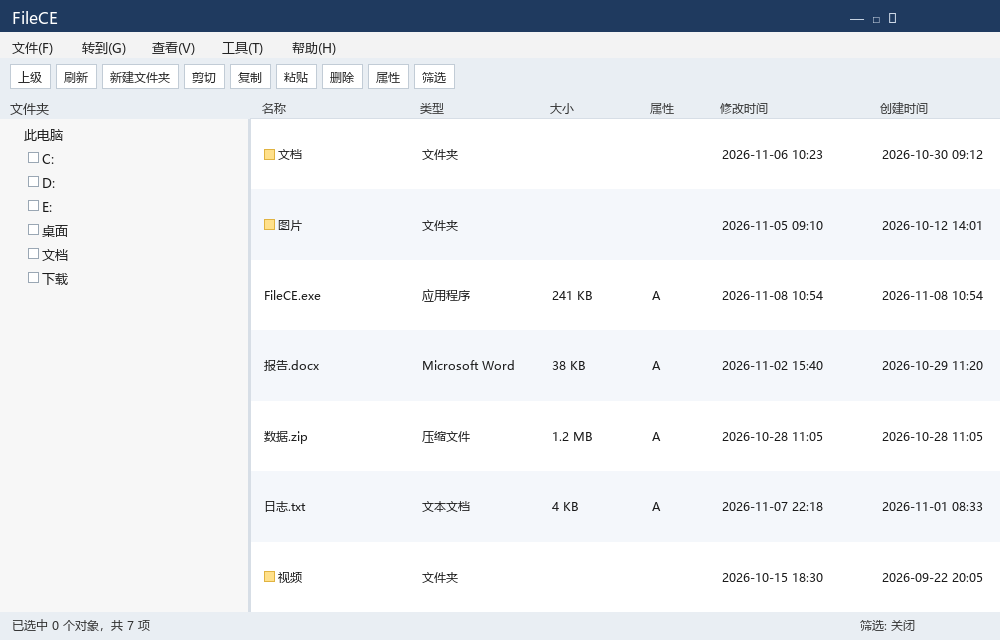

# FileCE

纯 C（C17）+ Win32 API 自研的轻量 Windows 文件管理器。单文件 exe、静态链接、零运行时依赖。

## 功能 / 性能

- 多标签浏览，文件夹树 + 文件列表双栏
- 地址栏跳转、面包屑、筛选（名称 / 时间 / 大小 / 类型）
- 系统右键菜单（打开方式、复制、重命名、属性…）
- 拖放：拖出到桌面 / 资源管理器，拖入即复制到当前目录
- 目录变更实时刷新、zip 解压
- 单文件 exe，约 204 KB，支持 Windows 7 SP1 x64 ~ Windows 11

## 构建

需要 MinGW-w64（`x86_64-w64-mingw32-gcc`）。在项目根目录执行：

    make

产物为 `build/FileCE.exe`（单文件、绿色便携）。

## 许可

[MIT](LICENSE)
